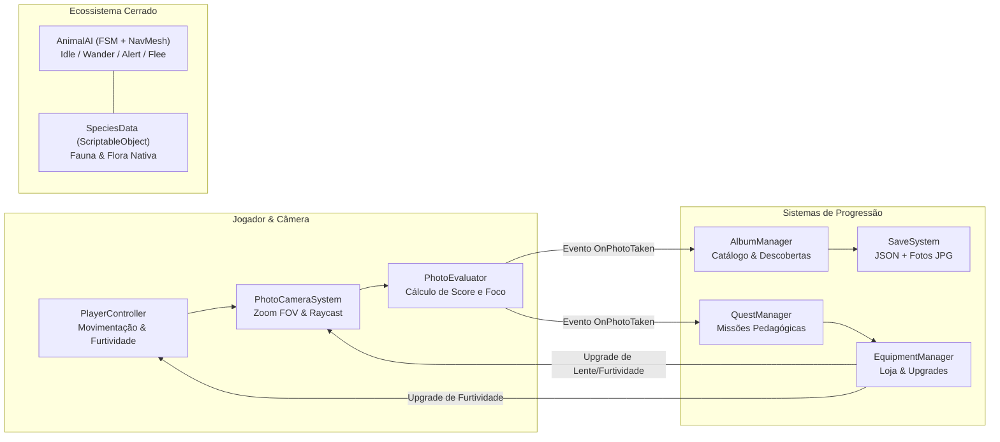

# EICerrado — Jogo Educativo 3D de Exploração e Fotografia Ambiental

<div align="center">

[](https://unity.com/)
[](https://learn.microsoft.com/dotnet/csharp/)
[](https://www.icmc.usp.br/)

</div>

**EICerrado** é um jogo 3D educativo de exploração em mundo aberto e simulação fotográfica desenvolvido na engine **Unity (Universal Render Pipeline — URP)** em **C#**, voltado à conscientização ambiental sobre a fauna e a flora do bioma **Cerrado brasileiro**. Desenvolvido no contexto acadêmico da **Universidade de São Paulo (USP)** para estudantes de 12 a 18 anos, o projeto combina mecânicas de *collection-based gameplay*, Inteligência Artificial comportamental e catalogação científica.

---

## 🧭 Índice de Navegação dos Módulos de Código (`Assets/Codigos`)

Documentação detalhada dos scripts disponível em **[`Assets/Codigos/README.md`](./Assets/Codigos/README.md)**.

| Módulo / Diretório | Namespace | Resumo Técnico e Conceitos de Engenharia |
|---|---|---|
| **[`Assets/Codigos/Photography/`](./Assets/Codigos/Photography/)** | `Cerrado.Photography` | Sistema de câmera com zoom óptico (FOV dinâmico), *Raycasting* anti-oclusão, avaliação matemática de enquadramento/distância e captura em `RenderTexture`/`Texture2D`. |
| **[`Assets/Codigos/AI/`](./Assets/Codigos/AI/)** | `Cerrado.AI` | Máquina de Estados Finitos (FSM: `Idle`, `Wander`, `Alert`, `Flee`) integrada ao `NavMeshAgent`, com sensibilidade furtiva e perfis de temperamento (`Docil`, `Cauteloso`, `Arisco`). |
| **[`Assets/Codigos/Album/`](./Assets/Codigos/Album/)** | `Cerrado.Album` | Catálogo enciclopédico reativo que registra a melhor fotografia de cada espécie, pontuação e progresso de descoberta do bioma. |
| **[`Assets/Codigos/Data/`](./Assets/Codigos/Data/)** | `Cerrado.Data` | Modelagem *Data-Driven* com `ScriptableObject` (`SpeciesData`) para atributos biológicos, nome científico, raridade e valor pedagógico. |
| **[`Assets/Codigos/Economy/`](./Assets/Codigos/Economy/)** | `Cerrado.Economy` | Sistema de economia e upgrades de equipamento (lentes teleobjetivas, estabilizadores de foco e botas furtivas). |
| **[`Assets/Codigos/Quests/`](./Assets/Codigos/Quests/)** | `Cerrado.Quests` | Motor de missões orientado a eventos (`OnPhotoTaken`) que guia a investigação ecológica do jogador. |
| **[`Assets/Codigos/Persistence/`](./Assets/Codigos/Persistence/)** | `Cerrado.Persistence` | Persistência local em JSON (`cerrado_save.json`) e exportação das fotos capturadas pelo jogador em arquivos `.jpg` no disco (`Application.persistentDataPath`). |
| **[`Assets/Codigos/Environment/`](./Assets/Codigos/Environment/)** | `Cerrado.Environment` | Ciclo dinâmico de dia e noite (`DayNightCycle`), atmosfera do Cerrado e gerenciamento de vegetação. |
| **[`Assets/Codigos/Player/`](./Assets/Codigos/Player/)** | `Cerrado.Player` | Controlador de movimentação 3D, mecânica de furtividade (redução de ruído/detecção pela fauna) e integração com o Unity Input System. |
| **[`Assets/Codigos/Interaction/`](./Assets/Codigos/Interaction/)** | `Cerrado.Interaction` | Sistema de interação com NPCs (Guia Ambiental e Loja de Equipamentos). |
| **[`Assets/Codigos/Exploration/`](./Assets/Codigos/Exploration/)** | `Cerrado.Exploration` | Barreiras de progressão (`AreaBarrier`) desbloqueadas conforme o avanço no Álbum de Espécies. |
| **[`Assets/Codigos/UI/`](./Assets/Codigos/UI/)** | `Cerrado.UI` | HUD do visor fotográfico, interface do Álbum, Loja e rastreador de missões desacoplados via *Observer Pattern* (`event Action`). |
| **[`Assets/Codigos/Editor/`](./Assets/Codigos/Editor/)** | `Cerrado.Editor` | Ferramentas customizadas de automação para o Unity Editor (geração e configuração de cenas, missões e itens de loja). |

---

## 🏗️ Arquitetura de Software e Padrões de Projeto



1. **Observer Pattern (Arquitetura Orientada a Eventos):**
   * O sistema fotográfico (`PhotoCameraSystem`) publica eventos estáticos (`OnPhotoTaken`, `OnAimStateChanged`, `OnTargetFocusChanged`). O `AlbumManager`, o `QuestManager` e as classes de `UI` reagem às capturas sem acoplamento direto entre os componentes.
2. **Data-Driven Design com `ScriptableObjects`:**
   * Novas espécies da fauna (Capivara, Tamanduá-bandeira, Tamanduá-mirim, Lobo-guará) e da flora (Ipê-amarelo, Sucupira, Aroeira), bem como missões (`QuestData`) e itens de loja (`ShopItemData`), são criados como *assets* independentes no Inspector, evitando alterações em código para expansão de conteúdo.
3. **Máquina de Estados Finitos (FSM) na IA da Fauna:**
   * Cada animal avalia continuamente a distância até o jogador e se o jogador está em modo furtivo (`IsCrouching`), alternando entre patrulha orgânica (`Wander`), estado de atenção (`Alert`) e evasão em direção oposta (`Flee`) sobre a malha de navegação (`NavMesh`).

---

## 🚀 Como Executar o Projeto no Unity Editor

### Pré-requisitos
* **Unity Hub** instalado.
* **Unity Editor 6000.0+ (Unity 6 LTS)** ou **2022.3 LTS+** com suporte a **Universal Render Pipeline (URP)**.

### Passo a Passo
1. Clone o repositório:
   ```powershell
   git clone https://github.com/AndreLuismain/JogoCerrado.git
   ```
2. Abra o **Unity Hub**, clique em **Add -> Add project from disk** e selecione a pasta `JogoCerrado`.
3. No Unity Editor, abra a cena principal em `Assets/Scenes/SampleScene.unity` (ou utilize o menu de automação customizado na barra superior `Cerrado -> Setup Completo da Cena`).
4. Pressione **Play** no Editor:
   * **Movimentação:** `W`, `A`, `S`, `D` | **Correr:** `Shift` | **Agachar (Furtivo):** `Ctrl` ou `C`
   * **Modo Fotografia:** Botão Direito do Mouse (`RMB`) para mirar | `Scroll` para Zoom Óptico | Botão Esquerdo (`LMB`) para fotografar
   * **Álbum Enciclopédico:** Tecla `Tab` ou `J`
   * **Interagir com NPCs (Guia / Loja):** Tecla `E`

---

## 👥 Autoria e Responsabilidades Técnicas

* **André Luís da Silva Souza** ([@AndreLuismain](https://github.com/AndreLuismain) — Sistemas de Informação, ICMC-USP): Arquitetura de software, programação de todos os sistemas em C# (IA, fotografia, álbum, missões, economia, persistência e ferramentas de Editor) e modelagem 3D base no Blender.
